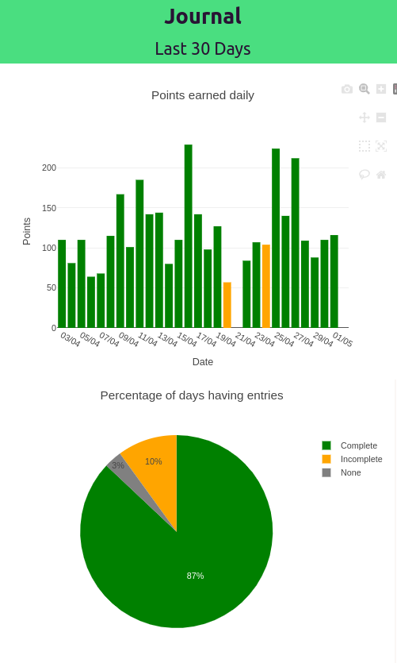
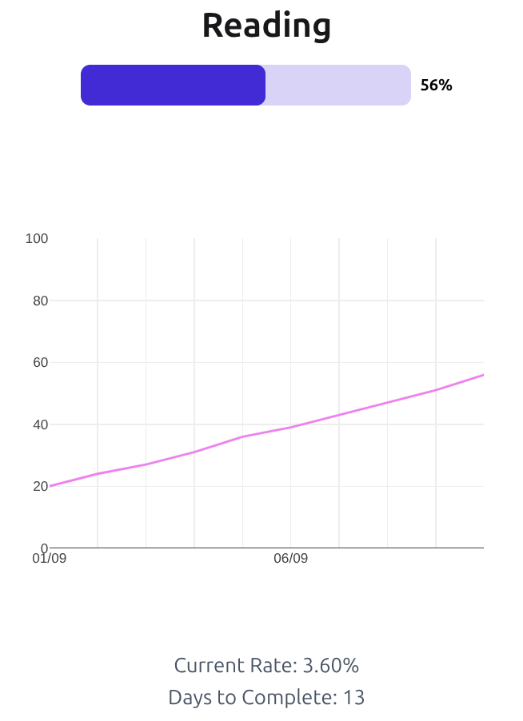
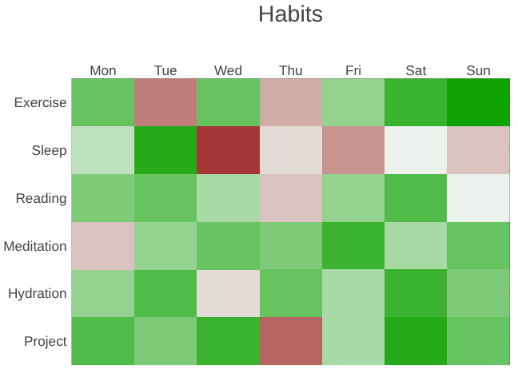

# Web Journal

A front end showing detailed data analysis based on personal journal.

Showing daily journal entry trends.

Tracking progress of peronal milestones.

Displaying daily habits.

## Tech stack

- Python based parser that parses the raw markdown files containing the journal entries.
  The data in then stored into the database.
  The script is run by a cron job on a predefined schedule to get new journal entries.
- SQLite database for storing the data.
- FastAPI as the server to query from the database and serve the frontend.
- Svelte for the frontend with typescript and daisy ui for styling. Plotly.js is used for ploting the graphs.

  The seperation of concerns in the stack really helps to split the logic into managable chunks.

## Keeping a Journal

As we get older, time seems to move faster.
The days are full, yet it becomes surprisingly easy to
forget what happened yesterday, let alone weeks ago.

To keep track of my daily life, I started keeping a journal.
I treat it a bit like a game: I assign points for completing
different tasks. It’s a simple system, but it’s been great for
staying motivated, especially when it comes to tedious chores.

But keeping the journal can itself start to feel like a chore.
So I wanted something that would make the process rewarding.
Visualizing my progress using the points, the habits, the trends
becomes a movtivating factor.

That is how this project came to be. A small site that turns
journal entries into clear, engaging visualizations. The goal
is to make the journal not just a log, but a source of motivation
to keep going every day.

## Journal

Although free writing text in the Journal is fun, the entries
needs to have some structure in order to for data analysis
later on.

The journal format is simple like:

25 April 2025
- Wake up early 5
- Make breakfast 10
- Work on project 20

Each entry has a number points at the end.
A rough estimate of the amount of effort I
think that task took.

Free writing texts are also allowed, they just would not have
the points attached to them.

## Analysis

A Python script processes the journal files and
imports the extracted data into a database.

The parser is kept in a private repository because
it contains personal parsing logic.

## Visualization

The code for visualizing the data is what this
repository is all about.

The website is static and is meant for being
hosted on a local server. For me it is a Raspberry Pi.

## Architecture

## Tech stack

- Python based parser that parses the raw markdown files containing the journal entries.
  The data in then stored into the database.
  The script is run by a cron job on a predefined schedule to get new journal entries.
- SQLite database for storing the parsed data.
- FastAPI as the server to query from the database and serve the frontend.
- Svelte for the frontend with typescript and daisy ui for styling. Plotly.js is used for ploting the graphs.

  The seperation of concerns in the stack really helps to split the logic into managable chunks.

## Future features

Use data from google timeline to track my movements for the day.

"On this Day" feature where it shows pictures and videos
on current day from previous years.

## Improvements

Containerized docker deployments to raspberry pi.

Add unit, integration, functional tests.

REST better handling of errors and proper error return codes.

Move computational logic from client to server.
